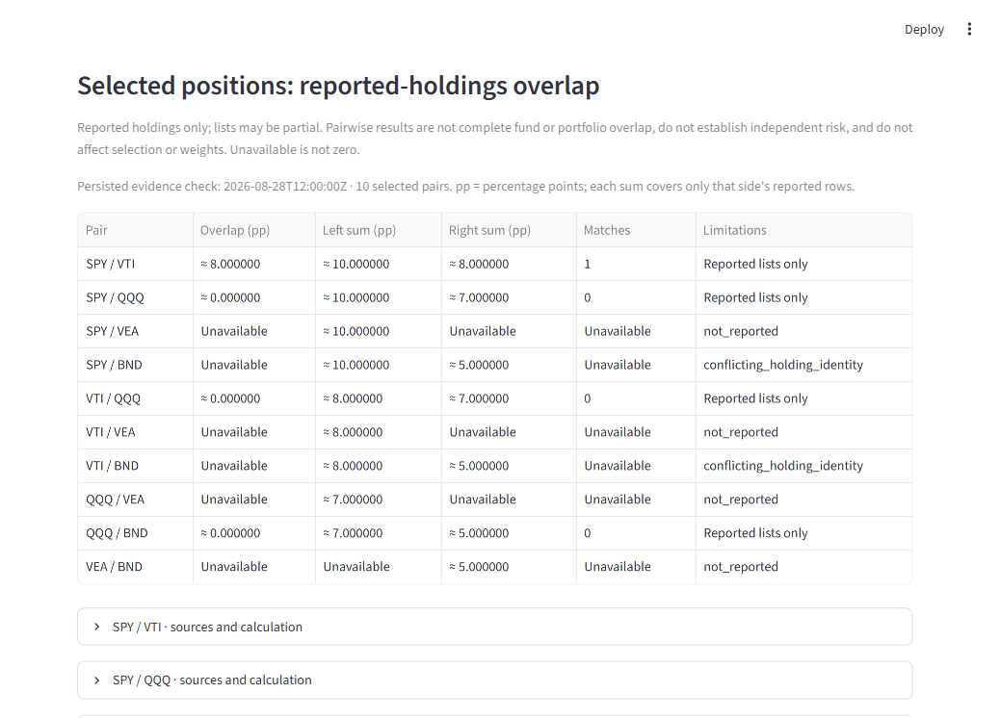

# Issue 24: selected-position reported-holdings comparisons

## Agreement, 14 November 2026

The user approved this bounded slice with “approved” in the current chat;
the [issue agreement](https://github.com/beagle1903/agentic-etf-advisor/issues/24#issuecomment-6874303633)
records the scope before implementation.
Part of [Issue 24](https://github.com/beagle1903/agentic-etf-advisor/issues/24);
broader #24, #117 and #123 remain open and deferred. One reviewable presentation
outcome needs no split or new issue. This does not reopen completed #101 acceptance.

Classification: ordinary presentation within existing contracts under ADRs
[0049](../architecture/decisions/0049-prospective-working-agreement.md) and
[0051](../architecture/decisions/0051-model-presets-and-assignments.md).
Accountable owner: current chat `/root`, performing `implementation_worker` work
through implementation, focused tests, self-review, verification and commit/push/PR.
No fresh preset dispatch or model override occurred. Routing target is `sol` /
`gpt-6.1-sol` / medium; runtime model and effort are not independently attested.
Inherited filesystem/network access is unrestricted, approval policy never;
scope restrictions are instruction-only. No separate access boundary is claimed.

Use isolated branch `codex/issue24-selected-holdings-pairs` from verified main
`745d0f4640cec70567e43f9e5908530785505db3`. Preserve the dirty default checkout,
other worktrees, environments, ignored evidence and all historical records.

Scope: automatically present the existing conservative reported-holdings results
for unordered pairs of selected draft document identities at human review.
Reuse `reported_holdings_overlap` and its saved evidence check time, exact units,
row sums, identity matching and provenance. Keep the manual two-candidate tool.
No financial, identity, security, persistence/replay or architecture contract changes.
Affected interfaces: ephemeral dashboard presentation and a pure pair enumerator.
Graph/checkpoint JSON and persisted state impact: **none**.

Non-goals: weighted/portfolio-wide aggregation, independent-risk or complete-overlap
claims, index/Fund inference, rules/ranking/optimizer/weights changes, new sources,
provider/store calls, collection, publication, registry/universe/storage/schema
changes, compatibility removal, migration/reset/deletion, credentials, trades or
external financial writes, broad cleanup and deferred-ticket resumes.

## Acceptance and verification plan

- AC24-P1: Exactly the unordered selected document-ID pairs; exclude unselected
  candidates. Up to five positions produces up to ten pairs. Larger custom-policy
  drafts get an explicit diagnostic-limit message, without truncating selection.
  Zero/one positions produce no pairs; duplicate or unknown IDs fail explicitly.
- AC24-P2: Preserve existing exact percentage-point results and rounding,
  per-side reported-row sums, matched-identity count, source/observation metadata,
  persisted check time and partial/unavailable/conflicting/stale/future labels.
  Unavailable never becomes zero. Keep manual comparison available.
- AC24-P3: Ready and detached/offline-restored rendering performs zero provider/store
  calls and leaves serialized graph JSON, source/artifact IDs, screening eligibility,
  selected positions, weights and cash identical.
- AC24-P4: Synthetic focused helper/UI checks cover membership, five-position bound,
  partial, zero and unavailable results. Run repository lint/format, typing,
  preset validation, service-free tests, build, Compose config and diff checks.
  Inspect presentation evidence; no live source pass is needed.

Self-review will check the actual validated review call path, document-ID mapping,
bounded pair enumeration, shared manual/automatic rendering, limitations and exact
state preservation. Consequential interpretation or material scope drift stops the
affected portion for separate architect advice/coordinator approval and user decision
where needed. No routine independent review layer is required for this scope.

## Implementation and self-review

`_render_run` passes only the validated review payload's draft position document
IDs to the pure enumerator. It creates unordered pairs in draft order and calls
the existing `reported_holdings_overlap` unchanged. The automatic view and manual
tool share the existing result renderer, retaining per-side source URLs,
observation times, reported-row sums, fixed reasons, snapshot/check metadata,
matched-identity counts and rational calculation details. The compact summary
explains percentage-point units and explicitly labels unavailable values.

The owner inspected the full diff against the base, including the shared-renderer
extraction: no changes to the existing pair calculation, field validation,
identity/freshness interpretation, persisted schema, financial rules, providers,
stores, eligibility, selection, weights, cash or historical records. The only
runtime additions are pair enumeration and presentation after validated review.
Custom-policy drafts above five retain their positions and get a limit message;
there is no truncated comparison pretending to cover a larger draft.

## Verification evidence, 14 November 2026 UTC

The focused command `uv run pytest tests/test_selected_holdings_overlap.py
tests/test_issue101_overlap.py tests/test_issue100_comparison.py
tests/test_dashboard.py -o addopts='' -q` passed **178 tests in 34.15 seconds**
before the final compact-heading polish. Final runtime verification is recorded
below after the full suite completes. The first focused attempt had two test
harness failures (a dict returned where the retriever protocol requires a typed
bundle, and an isolated AppTest function referencing an unimported annotation);
both were corrected. No failed attempt is acceptance evidence.

The new synthetic regression builds a real graph review from six evidence
documents and confirms the five selected positions exclude IVV. It independently
asserts all ten expected pairs, partial 8-point overlap with separate 10/8-point
row sums, explicit zero and unavailable/conflicting outcomes. Ready and detached
JSON-restored UI rendering runs with retriever, graph invocation, memory-store
reads/writes and socket connections forbidden. The complete serialized graph
state (including artifact IDs, screening, positions, weights and exact cash)
and detached interrupt payload remain identical. Restored results equal ready
results. Manual selection of unselected IVV still works without changing the
automatic table or state. This is offline rendering proof, not a PostgreSQL
process-restart demonstration or acceptance of broader Issue 117.

Additional focused cases cover exact non-ranked selected-ID membership, zero/one
positions, six-position rejection without truncation, duplicate/unknown IDs,
saved stale/future reasons and explicit larger-draft UI handling. Existing #101
checks retain schema-2 exact numeric proofs and official BND limitations.

A local synthetic browser preview of the same six-document graph reached Human
review at `http://127.0.0.1:8516`. The owner visually inspected the ten-pair table
and expanded SPY/VTI details at 1038 CSS-pixel viewport width: partial/zero/
unavailable values, all limitation columns, 10/8-point row sums, saved check and
source observation times, exact JSON and source URLs were visible. Long initial
headings were shortened so limitations fit without horizontal scrolling. The
preview used synthetic `example.test` holdings URLs and no source pass. The
temporary preview server was stopped; ignored local evidence is retained under
`.artifacts/issue24-preview/`.

Locked dashboard-extra environment: Windows, Python 3.13.14, Streamlit 1.62.0,
dependencies installed with `uv sync --frozen --extra dashboard`. Ruff lint and
format (277 files), mypy (69 source files), preset validator, build, Compose config,
23 relative document links and diff checks passed. Live providers and optional
real stores are not used or required for this presentation-only change. Earlier
broad runs were interrupted while finalizing table labels and are not claimed
as completed passes.

One full run failed with **1,726 passed, 71 skipped and one failure**: the owner
added forbidden-call counters to the test file after pytest loaded it. AppTest's
source inspection then used old line offsets against that changed file and
extracted the wrong function (`render` was undefined). This is not a passing
run. With files held unchanged, a fresh screening-plus-new-tests run passed
**69 tests**, and the final full command `uv run --frozen pytest -o addopts='' -q`
passed **1,727 tests, 71 optional skips in 264.13 seconds**. The final nine new
tests also passed independently in 3.46 seconds, including explicit forbidden-call
counters. The final full log remains ignored at
`.artifacts/issue24-preview/full-final.log`.

All eight pre-existing diagnostic functions have identical syntax trees to the
base (decoded as UTF-8); the pair calculation and evidence interpretation are
unchanged. Ruff lint/format and diff checks passed after the final test-only
counter addition. AC24-P1 through AC24-P4 pass locally. PR publication/CI remains
the delivery step; no merge or wider financial-readiness acceptance is claimed.
